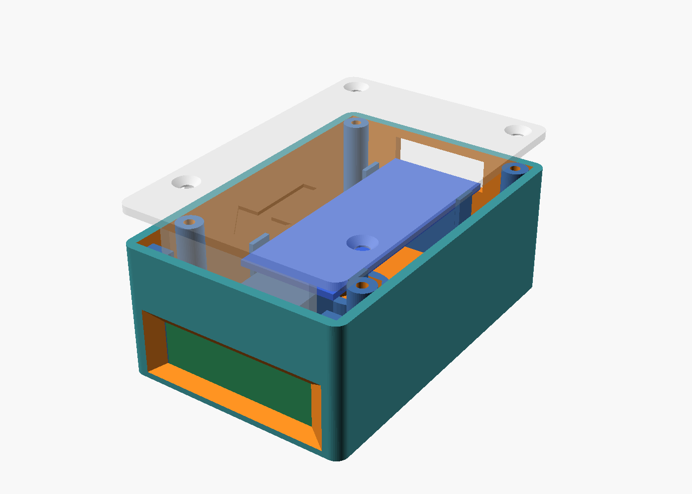

# Radar enclosure (3D print)

Box for one RD-03D radar plus its bridge board. Outside size **58 × 87 × 33 mm**. The radar looks out through an open window at the front (no plastic in front of the antennas). USB comes out the back. The engraved arrow on the lid points where the radar looks. Use it to set `yaw_deg` in the site file.



## Files

| File | Print | Notes |
|---|---|---|
| `stl/radar_base_esp32.stl` | 1 | Main build: ESP32-S3-DevKitC-1 bridge |
| `stl/radar_base_usbserial.stl` | (instead) | Small USB-serial board on a pad. See the power note in `docs/radar.md`. |
| `stl/radar_lid.stl` | 1 | Already flipped for printing (top face down) |
| `radar_enclosure.scad` | | Source. Every size is a setting at the top of the file. |

Re-export after changing a setting (OpenSCAD 2025+ / snapshot):

```sh
openscad -D 'part="base"' -D 'bridge="esp32"' -o stl/radar_base_esp32.stl radar_enclosure.scad
openscad -D 'part="lid"' -o stl/radar_lid.stl radar_enclosure.scad
```

## Before printing: measure

Sizes come from the datasheets (RD-03D 44.0 × 15.0 mm; ESP32-S3-DevKitC-1 62.7 × 25.4 mm). Clone boards differ, so check yours with calipers:

- `radar_t`: radar board thickness (1.6 assumed)
- `esp_w`: ESP32 board width. The bay takes boards up to 70 mm long without changes.

## Print settings

PLA or PETG, 0.2 mm layers, 3 walls, 20 % infill, **no supports** (the window and USB opening bridge fine). Base prints open side up. Lid prints as exported.

## Hardware

- 4 × M3 × 8 mm self-tapping screws (or M3 machine screws: run one in first to cut threads)
- 1 × 1/4"-20 hex nut (optional, makes the bottom a tripod mount)
- Double-sided foam tape
- The radar's 4-wire cable with dupont sockets on the far end (it usually comes with the module)

## Assembly

1. Optional: press the 1/4"-20 nut into the hex pocket in the floor.
2. Plug the cable into the radar. Slide the radar down into the two front grooves, antenna side facing the window and connector facing in.
3. Push the dupont sockets onto the ESP32's downward pins: radar **5V → 5V**, **GND → GND**, **TX → GPIO17**, **RX → GPIO18**. The board sits 21 mm up so the sockets fit underneath.
4. Set the ESP32 on its two ledges, USB end against the back wall with the ports in the opening. Stick it down with a square of foam tape on each ledge.
5. Lid on (the tab on its underside holds the radar in its grooves), 4 screws.
